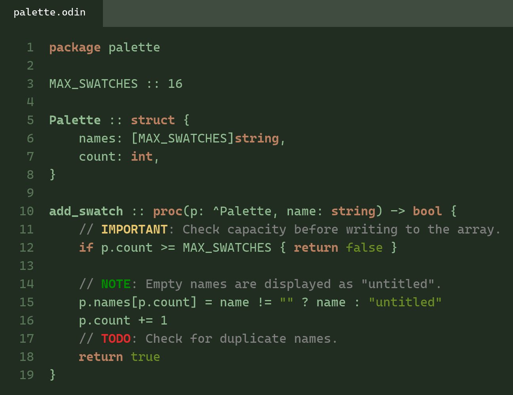

# Odin Grove

A forest-green theme for Visual Studio Code. Odin code uses sage identifiers and copper keywords. Procedure, struct, and enum declarations are bold and upright. Value constants use regular weight. In comments, `TODO` is red, `NOTE` is green, and `IMPORTANT` is gold.



## Install

1. Save [odin-grove-1.1.4.vsix](./odin-grove-1.1.4.vsix) to your computer, or use the copy in this folder.
2. In VS Code, open the Command Palette with **F1**, run **Extensions: Install from VSIX…**, and select the file. [VS Code installation guide](https://code.visualstudio.com/docs/configure/extensions/extension-marketplace#_install-from-a-vsix).
3. Open the Command Palette again, run **Preferences: Color Theme**, and choose **Odin Grove**.

If you use the VS Code CLI, you can install or update the extension from this folder with the following command. After the first install, select the theme as in step 3.

```sh
code --install-extension ./odin-grove-1.1.4.vsix
```

## Match the preview

The preview uses **Cascadia Code**. With the font installed, set **Editor: Font Family** to `'Cascadia Code', monospace` in VS Code Settings. To see the same highlighting, open the sample with the **Odin Language** extension (`danielgavin.ols`) enabled. [View the Odin sample](./examples/palette.odin).
